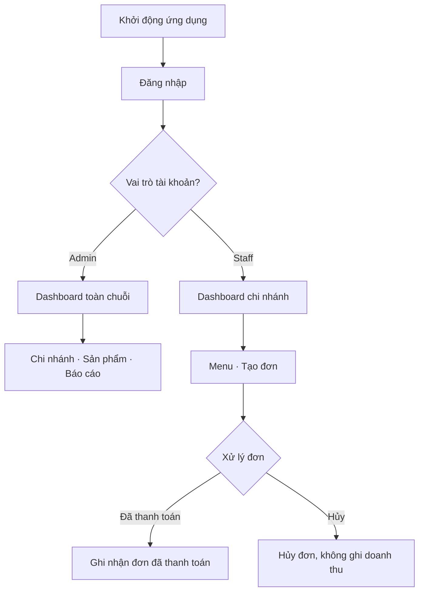
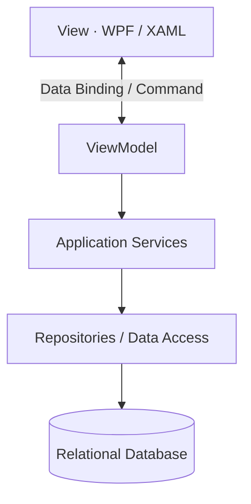

<div align="center">

<h1>☕ CoffeeChain</h1>

<h3>Hệ thống quản lý chuỗi quán cà phê</h3>

<p><strong>Ứng dụng Desktop dành cho quản lý nhiều chi nhánh, bán hàng và theo dõi hiệu quả kinh doanh.</strong></p>

<p>
  
  
  
  
</p>

<p>
  
  
  
</p>

<p>
  <a href="#tong-quan">Tổng quan</a> ·
  <a href="#tinh-nang-du-kien">Tính năng</a> ·
  <a href="#kien-truc-he-thong">Kiến trúc</a> ·
  <a href="#cai-dat-va-chay">Cài đặt</a> ·
  <a href="#lo-trinh-phat-trien">Lộ trình</a>
</p>

</div>

---

> [!IMPORTANT]
> **Trạng thái dự án: đang phân tích và thiết kế.** README mô tả **các chức năng dự kiến**, không khẳng định chúng đã được lập trình. Tài liệu đặc tả hiện tại là **SRS v0.1 (bản nháp)**; một số quyết định nghiệp vụ và công nghệ còn chờ nhóm xác nhận.

<a id="tong-quan"></a>

## 🌟 Tổng quan

**CoffeeChain** là đồ án môn **Lập trình trực quan (IT008)**, hướng tới xây dựng ứng dụng **Windows Desktop bằng C# và WPF** để quản lý hoạt động của một chuỗi quán cà phê.

Hệ thống tập trung vào hai nhóm người dùng:

- **Admin:** quản lý và theo dõi số liệu kinh doanh của **toàn chuỗi**.
- **Staff:** quản lý hoạt động bán hàng tại **chi nhánh được phân công**.

### 🎯 Mục tiêu

- Tập trung thông tin chi nhánh, sản phẩm, đơn hàng và doanh thu vào một hệ thống.
- Cung cấp dashboard trực quan giúp Admin theo dõi tình hình kinh doanh.
- Hỗ trợ Staff tạo đơn và **mô phỏng** xác nhận/hủy thanh toán.
- Xây dựng giao diện WPF nhất quán, có **Data Binding, Command và mô hình MVVM**.
- Tổ chức mã nguồn dễ bảo trì, kiểm thử và làm việc nhóm qua Git.

<a id="tinh-nang-du-kien"></a>

## ✨ Tính năng dự kiến

<table>
  <thead>
    <tr><th>👑 Admin — Quản lý toàn chuỗi</th><th>🧑‍🍳 Staff — Vận hành chi nhánh</th></tr>
  </thead>
  <tbody>
    <tr><td>📊 Dashboard doanh thu, chi phí, lợi nhuận và số chi nhánh hoạt động</td><td>🏠 Dashboard tên chi nhánh, doanh thu hôm nay và số đơn</td></tr>
    <tr><td>📈 Biểu đồ xu hướng doanh thu/lợi nhuận và tỷ trọng doanh thu theo chi nhánh</td><td>☕ Xem menu, giá và số lượng sản phẩm còn lại</td></tr>
    <tr><td>🏪 Quản lý chi nhánh; tìm kiếm theo tên, đánh giá sao và trạng thái</td><td>🛒 Chọn món, nhập số lượng, lập đơn và tính tổng tiền</td></tr>
    <tr><td>📋 Quản lý sản phẩm, menu dùng chung và top 5 món bán chạy</td><td>✅ Chọn <strong>Đã thanh toán</strong> hoặc ❌ <strong>Hủy</strong></td></tr>
  </tbody>
</table>

**Chức năng dùng chung:** đăng nhập bằng username/password, kiểm tra dữ liệu đầu vào, xác thực từ cơ sở dữ liệu, điều hướng theo vai trò và đăng xuất.

<details>
<summary><strong>🧩 Các hạng mục mở rộng đang đề xuất trong SRS v0.1</strong></summary>

Các hạng mục này **chưa được chốt** với nhóm:

- Quản lý tồn kho **riêng cho từng chi nhánh**, lưu lịch sử nhập/điều chỉnh.
- Quản lý tài khoản Staff và chi nhánh được phân công.
- Ghi nhận khoản chi để tổng hợp **lợi nhuận ước tính theo chi phí đã nhập**.
- Lịch sử đơn hàng, lọc trạng thái và khoảng thời gian.
- Ngừng hoạt động sản phẩm/chi nhánh (soft delete) để giữ lịch sử giao dịch.

</details>

## 🔀 Luồng hoạt động



> [!NOTE]
> Thanh toán **chỉ mô phỏng** bằng hai lựa chọn **“Đã thanh toán”** và **“Hủy”**. Dự án không tích hợp cổng thanh toán thật trong phạm vi MVP.

### Quy tắc nghiệp vụ trọng tâm *(theo SRS v0.1, cần xác nhận)*

| Quy tắc | Cách xử lý dự kiến |
|---|---|
| Thực đơn | Các chi nhánh dùng chung danh sách món và giá bán. |
| Doanh thu | Chỉ tính các đơn đã thanh toán (`PAID`). |
| Hủy đơn | Đơn `CANCELLED` không làm tăng doanh thu. |
| Tồn kho | Theo từng cặp chi nhánh–sản phẩm; không cho âm kho. |
| Giá lịch sử | Giá bán tại lúc chốt đơn được lưu để không bị thay đổi khi cập nhật menu. |
| Lợi nhuận | Doanh thu trừ khoản chi đã ghi nhận; có thể là số liệu ước tính nếu chi phí chưa đầy đủ. |

<a id="kien-truc-he-thong"></a>

## 🧱 Kiến trúc hệ thống

Dự án định hướng theo **MVVM (Model–View–ViewModel)** và phân tách phần hiển thị, xử lý nghiệp vụ, truy cập dữ liệu.



| Thành phần | Công nghệ / định hướng | Trạng thái |
|---|---|---|
| Ứng dụng | Windows Desktop, **WPF + XAML** | Đã xác định |
| Ngôn ngữ | **C# / .NET** | Đã xác định; phiên bản .NET chưa chốt |
| UI architecture | **MVVM**, `INotifyPropertyChanged`, `ObservableCollection`, `ICommand` | Định hướng theo tiêu chí đồ án |
| Bố cục giao diện | `Grid`, `StackPanel`, `DockPanel`, `ResourceDictionary`, `Style` | Dự kiến |
| Truy cập dữ liệu | Repository, có thể sử dụng **EF Core** | Đề xuất |
| Database | **SQL Server / PostgreSQL / SQLite** | **Chưa lựa chọn** |
| Quản lý phiên bản | **Git / GitHub** | Theo quy trình nhóm |

<details>
<summary><strong>📂 Cấu trúc repository đề xuất</strong></summary>

> Cây thư mục dưới đây là **mục tiêu tổ chức mã nguồn**, chưa phải danh sách file đã tồn tại.

```text
CoffeeChain/
├── src/
│   ├── CoffeeChain.Wpf/
│   │   ├── Views/
│   │   │   ├── Auth/
│   │   │   ├── Admin/
│   │   │   └── Staff/
│   │   ├── ViewModels/
│   │   ├── Resources/
│   │   └── Converters/
│   ├── CoffeeChain.Application/
│   │   ├── Services/
│   │   ├── DTOs/
│   │   └── Validators/
│   ├── CoffeeChain.Domain/
│   │   ├── Entities/
│   │   └── Enums/
│   └── CoffeeChain.Infrastructure/
│       ├── Persistence/
│       └── Repositories/
├── tests/
├── docs/
│   ├── SRS.md
│   └── Report.md
├── .gitignore
├── CoffeeChain.sln             # Dự kiến khi tạo solution
└── README.md
```

</details>

## 🖥️ Giao diện dự kiến

Thiết kế ưu tiên sidebar gọn gàng, các thẻ thống kê dễ đọc, bảng dữ liệu có tìm kiếm và biểu đồ rõ ràng.

| Màn hình | Nội dung chính |
|---|---|
| 🔐 **Login** | Form username/password, kiểm tra lỗi và phân quyền |
| 📊 **Admin Dashboard** | KPI và biểu đồ doanh thu/lợi nhuận |
| 🏪 **Quản lý chi nhánh** | Danh sách, trạng thái, đánh giá sao, tìm kiếm, biểu mẫu CRUD |
| ☕ **Quản lý sản phẩm** | Thực đơn chung và top 5 bán chạy |
| 🧾 **Staff Dashboard / Order** | Menu, số lượng còn lại, giỏ hàng và xác nhận/hủy đơn |

> **Ảnh giao diện:** sẽ bổ sung ảnh chụp thực tế vào `docs/assets/` sau khi có UI. Hiện tại dự án chưa có ảnh demo để công bố.

<a id="cai-dat-va-chay"></a>

## 🚀 Cài đặt và chạy

> [!WARNING]
> **Chưa có bản build để tải hoặc chạy.** Các bước sau là hướng dẫn **dự kiến khi mã nguồn được hoàn thiện**; cần cập nhật sau khi chốt phiên bản .NET, CSDL và tên project.

**Yêu cầu môi trường dự kiến:**

- Windows 10/11.
- Visual Studio có workload **.NET desktop development**.
- .NET SDK tương ứng phiên bản mà nhóm sẽ sử dụng.
- Hệ quản trị cơ sở dữ liệu được chọn sau khi chốt kiến trúc.

Khi repository đã có solution và project theo cấu trúc phía trên:

```bash
# Clone bằng URL thực tế của repository trên GitHub
git clone YOUR_REPOSITORY_URL
cd YOUR_REPOSITORY_NAME

# Khôi phục dependencies và build
dotnet restore CoffeeChain.sln
dotnet build CoffeeChain.sln -c Release

# Chạy dự án WPF (sau khi đã cấu hình cơ sở dữ liệu)
dotnet run --project src/CoffeeChain.Wpf
```

**Cấu hình database:** sẽ được hướng dẫn khi nhóm chọn SQL Server, PostgreSQL hoặc SQLite. Không commit mật khẩu hay chuỗi kết nối chứa thông tin nhạy cảm lên GitHub.

<a id="lo-trinh-phat-trien"></a>

## 🗺️ Lộ trình phát triển

- [x] Xây dựng ý tưởng và báo cáo yêu cầu ban đầu (`Report.md`).
- [x] Soạn bản nháp đặc tả **SRS v0.1**.
- [ ] Thống nhất phạm vi MVP, các hạng mục đề xuất và công nghệ CSDL.
- [ ] Thiết kế database/ERD và giao diện mẫu.
- [ ] Khởi tạo WPF solution, cấu trúc MVVM và Resource Styles.
- [ ] Hoàn thiện đăng nhập, phân quyền Admin/Staff.
- [ ] Xây dựng chức năng quản lý chi nhánh và sản phẩm.
- [ ] Phát triển order và thanh toán mô phỏng.
- [ ] Hoàn thiện dashboard, biểu đồ, báo cáo doanh thu.
- [ ] Kiểm thử, chuẩn bị dữ liệu demo và hoàn thiện tài liệu.

## 📚 Tài liệu dự án

| Tài liệu | Mô tả |
|---|---|
| [📄 SRS v0.1](docs/SRS.md) | Đặc tả chức năng, quy tắc nghiệp vụ, kiến trúc đề xuất và test cases |
| [📝 Report ban đầu](docs/Report.md) | Ý tưởng và các luồng nghiệp vụ gốc |

> Hai đường dẫn trên hoạt động nếu giữ cấu trúc `docs/` như trong gói repository đi kèm.

## 🎓 Định hướng đáp ứng tiêu chí đồ án IT008

| Tiêu chí | Trọng số | Hướng thể hiện |
|---|---:|---|
| Chức năng & hoàn thiện | 2.0 | CRUD, xác thực, bán hàng, nhập liệu sai, tính ổn định |
| Giao diện | 2.0 | Layout WPF, Style/Resource, co giãn cửa sổ |
| Data Binding, Command, MVVM | 3.0 | ViewModel, `DataContext`, Binding, `ICommand` |
| Cấu trúc mã nguồn | 1.0 | OOP, phân lớp, Git và code dễ bảo trì |
| Teamwork | 0.5 | Kế hoạch, phân công, lịch sử commit |
| Demo & hỏi đáp | 1.5 | Demo nghiệp vụ và giải thích kỹ thuật WPF |

*Theo phiếu đánh giá, tiêu chí “Template, đồ họa, đa luồng” (3 điểm) là lựa chọn **thay thế** mục MVVM/Binding/Command, không cộng thêm vào tổng điểm.*

## 🤝 Đóng góp và làm việc nhóm

Dự án phục vụ mục đích học tập. Quy trình làm việc dự kiến:

1. Mỗi chức năng thực hiện trên một nhánh riêng, ví dụ `feature/login`, `feature/admin-dashboard`.
2. Viết commit rõ nội dung, mở Pull Request trước khi gộp vào nhánh chính.
3. Cập nhật tài liệu khi thay đổi luồng nghiệp vụ, cấu trúc dữ liệu hoặc cách chạy.
4. Không đưa mật khẩu, file build, thư mục `bin/`, `obj/` hoặc dữ liệu cá nhân lên repository.

**Thành viên và phân công:** sẽ cập nhật khi nhóm chốt danh sách.

---

<div align="center">
  <p><strong>☕ CoffeeChain — Better management, one branch at a time.</strong></p>
  <sub>Đồ án Lập trình trực quan (IT008) · C# · WPF · MVVM</sub>
</div>
